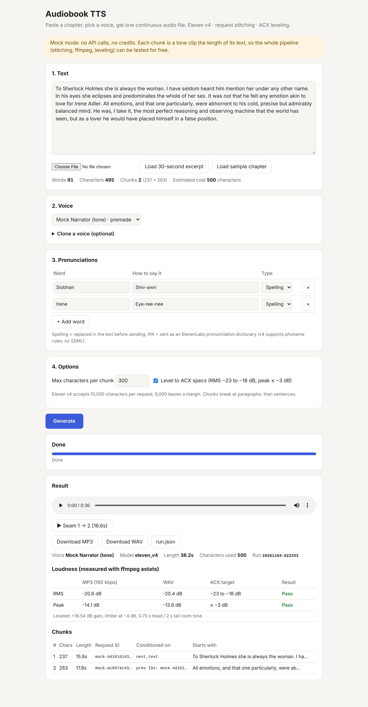

# Audiobook TTS: one chapter in, one seamless audio file out

A small local app built on the **ElevenLabs API** and the **Eleven v4** model. You paste a chapter (3,000+ words is fine), pick a voice and click **Generate**. You get back one continuous MP3 or WAV with no change in the voice between sections, optionally leveled to Audible/ACX upload specs.


*A real run: the 30-second excerpt in 2 chunks, voice "George", leveled to ACX. Replace `docs/screenshot.png` with your own capture any time.*

## What it does

- **Text in.** Paste text or upload a `.txt` file. Before you spend anything, the page shows the word count, the character count and the estimated cost in characters.
- **Voices.** Lists the voices on your ElevenLabs account. It can also create an instant voice clone from 1–3 samples, but only after you tick *"I have permission to clone this voice."*
- **Pronunciations.** A small table of words and how to say them (e.g. *Siobhan → Shiv-awn*). You can also enter IPA, which is sent as an ElevenLabs pronunciation dictionary.
- **Long text.** The text is split into chunks of up to about 9,000 characters (Eleven v4 accepts 10,000 per request). Splits happen at paragraphs first, then at sentences, never in the middle of a sentence.
- **Reliable.** Busy or failed requests are retried automatically. If a chunk still fails, the app stops and tells you which one. Finished chunks are already saved, so clicking Generate again resumes the run without paying for them twice.
- **Audiobook-ready export.** The chunks are joined with ffmpeg into a 44.1 kHz / 192 kbps MP3 and a WAV. An optional ACX setting levels the audio to RMS between −23 and −18 dB and peaks no higher than −3 dB. The page shows the *measured* numbers and a **▶ Seam** button that jumps to each join, so you can hear that it's seamless.
- **A record of every run.** Each run gets its own folder, `output/<timestamp>/`, containing:
  - the chunk files and the final audio;
  - `run.json` (voice, model, chunk sizes, request IDs, characters used).

## Setup in 5 steps

1. **Install the tools.** You need [uv](https://docs.astral.sh/uv/) (or Python 3.11+) and ffmpeg (`brew install ffmpeg` on macOS, `sudo apt install ffmpeg` on Ubuntu).
2. **Get the code.** `git clone <this repo> && cd upwork-spike-elevelabs`
3. **Add your key.** `cp .env.example .env`, then paste your ElevenLabs API key after `ELEVENLABS_API_KEY=`.
4. **Start it.** `uv run python -m app` (or `uv run python -m app --mock` to try it for free, with tone clips instead of a voice).
5. **Open it.** Go to **http://localhost:8000**, paste a chapter, pick a voice and click **Generate**.

**Plan and key notes:**
- **Below the Creator plan:** the API refuses 192 kbps MP3. The app then asks for 128 kbps automatically and still exports the final MP3 at 192 kbps. Re-encoding doesn't add quality: the source is still 128 kbps.
- **Free plan:** audio is for non-commercial use and must credit ElevenLabs.
- **Restricted API keys:** the key needs *Text to Speech* permission.
  - *Voices read:* without it, the picker shows ElevenLabs' built-in premade voices.
  - *Voices write:* needed for cloning.
  - *Pronunciation dictionaries write:* needed for IPA rules.

## How it keeps the voice consistent

The model can't read a whole chapter in one request, so the chapter is read in a few long pieces. Read separately, each piece could start with a slightly different tone, pace or energy, and the joins would be audible. Three things prevent that:

1. **Each piece is told what came before it.** When the app asks for piece 2, it hands ElevenLabs a receipt for piece 1. That receipt is the *request ID*, and ElevenLabs uses it to remember exactly how piece 1 sounded, so piece 2 carries on in the same voice, at the same pace and in the same mood. Later pieces get receipts for up to three earlier ones.
2. **Each piece is also told what comes next.** The app passes along the opening lines of the following piece. The narrator then ends each piece the way a person would in the middle of a story, not with a "the end" drop in tone.
3. **One piece at a time, in order.** A piece is only sent after the previous one has fully finished. That guarantees its receipt is ready to hand on.

The pieces are also big, about 10 minutes of audio each, so a 3,000-word chapter has just two seams. Splits always fall at a paragraph or sentence break, where a human narrator would pause anyway.

## Testing without spending credits

```bash
uv run pytest -q
```

```bash
uv run python -m app --mock
```

- **`uv run pytest -q`** covers the chunker, pronunciation replacement, and the stitching loop with a fake ElevenLabs client: order, request IDs passed forward, retries, stopping at a failed chunk, resuming, and expired IDs. It also runs an end-to-end pass through the API and ffmpeg.
- **`uv run python -m app --mock`** (or `MOCK_TTS=1`) runs the whole app with tone clips instead of speech, so the page, the progress bar, the joining and the leveling can all be tried for free.

The one real check is `uv run python scripts/smoke_test.py`, which sends about 200 characters.

## Free hosting (static replay demo)

A live copy on the open internet would let anyone spend your credits. The hosted demo is a **replay** instead: you generate a short clip once, locally, and export it as plain static files. The page plays back the real audio, request IDs and loudness numbers, and a banner says it's a replay. There is no server and no API key, so it runs on any free static host.

```bash
uv run python -m app export-site output/<run-folder> --out site
```

This repo already includes a ready-made `site/` from one real run: the 30-second excerpt, 500 characters, Eleven v4, voice "George". Deploy the `site/` folder:

- **Cloudflare Pages:** run the command below, or in the dashboard connect the repo with build command *(none)* and output directory `site`.

  ```bash
  npx wrangler pages deploy site --project-name audiobook-demo
  ```

- **Vercel:** run the command below. Or import the repo with Root Directory `site` and Framework *Other*.

  ```bash
  npx vercel deploy site --prod
  ```

- **Netlify / GitHub Pages:** publish the `site/` folder as-is.

Then add a custom domain in the host's dashboard; it shows you the CNAME record to create.

**Live copy: https://tts.hueman.dev** (also https://audiobook-tts-demo.vercel.app)
- **Hosting:** Vercel project `audiobook-tts-demo`. DNS is a Cloudflare CNAME `tts` → `cname.vercel-dns.com`, not proxied.
- **What Vercel serves:** the text files in `site/`, plus [`deploy/vercel.json`](deploy/vercel.json).
- **Audio:** those rewrites serve the two audio files from jsDelivr, pinned to the commit that added them. The files stay on this site's URL, so the download buttons still work.

## Notes from the ElevenLabs docs (checked Nov 2026)

- **Model:** `eleven_v4`, 10,000 characters per request.
- **`previous_text` is ignored when `previous_request_ids` is sent**, so the app sends one or the other.
  - Up to 3 IDs, closest last.
  - IDs expire after **2 hours**. A run resumed later falls back to `previous_text` automatically.
- **No SSML on v4**, so no inline `<phoneme>` tags. Phoneme (IPA) rules *do* work on v4 through pronunciation dictionaries. v4 has no Style or Speed sliders.
- **Instant cloning:** `voices.ivc.create(name, files)`.
- **Plans:** WAV/PCM output straight from the API needs the Pro plan. The app requests MP3 and makes the WAV locally with ffmpeg.

## Project layout

```
app/chunker.py      split text (pure, tested)
app/pronounce.py    pronunciation rules (pure, tested)
app/tts.py          ElevenLabs client + mock + retry
app/pipeline.py     stitching loop, resume, run.json
app/audio.py        ffmpeg join / ACX leveling / measurement
app/server.py       FastAPI routes;  app/static/index.html  the page
app/export_site.py  static replay export
samples/            public-domain chapter (~3,400 words) + 30-second excerpt
scripts/smoke_test.py
```
